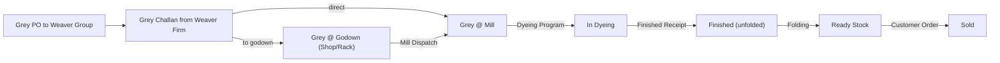

# 01 — Business Understanding (Vinee Creation)

> Source of truth for the domain. Captured from the client brief (2026‑10‑07).
> If code and this file disagree, this file wins unless PROGRESS.md records a decision.

## Who is the client
**Vinee Creation** is a **textile trader**. They do **no manufacturing**. They:
1. Buy **grey (undyed) fabric** from **weavers**.
2. Get it **dyed** at **mills** (job work) as per a **dyeing program**.
3. **Fold** the finished fabric and sell it to **customers** who place orders.

Everything is counted in **taka** (a roll/piece of fabric) and **meters**.

## Glossary
| Term | Meaning |
|---|---|
| **Taka** | One roll of fabric. Nominal ~100 m, actual 94–104 m with decimals (e.g. 94.69, 102.58). Every taka is tracked individually from weaver → folding. |
| **Grey** | Undyed fabric as it comes from the weaver. |
| **Quality** | Fabric type. Has **two names**: `original_name` (weaver's name, e.g. *Nylon*) and `nick_name` (Vinee's trade name, e.g. *Gold Lava*). |
| **Weaver Group (Party Group)** | One owner with several firms. e.g. *Ganesh Textile* group owns *Ganesh Fabrics* and *Ganesh Fashion*. |
| **Weaver (Party)** | A firm inside a group. POs go to the **group**; challans come from a specific **firm**. |
| **Grey PO** | Vinee's purchase order to a weaver group: quality, meters, rate/m. e.g. 50,000 m @ ₹3.50. Today written on paper. |
| **Grey Challan / Receipt** | Delivery from a weaver firm against a PO. Can be **partial**. Contains many takas with meters. |
| **Direct‑to‑Mill** | Weaver sometimes sends grey **directly to a mill**, not to Vinee's godown. |
| **Location** | Physical place in Vinee's godown: `Shop` + `Rack` (e.g. *Shop 6065 / Rack‑A*). |
| **Mill Dispatch** | Vinee sends grey takas from its godown to a mill. Challan shows **nick name**. |
| **Dyeing Program** | Instruction to the mill in **takas**: quality + shade chart + shade numbers (e.g. 48 taka → 24 × Shade 37, 24 × Shade 39). Printed as PDF with shade colour swatches. |
| **Shade Chart / Shade** | Colour catalogue (Chart‑A) with numbered shades (36, 37 …) and a colour. |
| **Finished Receipt** | Mill returns dyed fabric against a program number, giving **grey meter** and **finished meter** per taka. |
| **Folding** | Vinee staff re‑measure finished fabric. **Folded meter** is the final truth. |
| **Customer Order** | Customer orders by nick name + shade + taka count. e.g. Gold Lava: 50 taka Shade 38, 50 taka Shade 39. |

## End-to-end flow

## Taka lifecycle (status)
`GODOWN_GREY` → `MILL_GREY` → `IN_DYEING` → `FINISHED` → `FOLDED` → `SOLD`
(Direct‑to‑mill takas start at `MILL_GREY`.)

## Shrinkage / wastage (per taka, start to end)
| Stage | Formula | Notes |
|---|---|---|
| Weaver shrinkage | `nominal_length − grey_meter` | nominal = PO taka length (default 100 m). PO-level also: ordered − received. **Omitted for direct‑to‑mill takas.** |
| Finished (dyeing) shrinkage | `grey_meter − finished_meter` | From mill challan. |
| Folding shrinkage | `finished_meter − folded_meter` | Mill sometimes over‑reports. |
| **Total** | `start − folded_meter` | start = nominal (godown) or grey_meter (direct). Show m and %. |

## Business rules
1. PO is placed to a **group**; receipt must pick a **firm of that group**.
2. PO status: `OPEN` (0 received) → `PARTIAL` → `COMPLETED` (manual close allowed, e.g. 49.3k of 50k).
3. Taka entry must be **fast**: enter many takas in one go (paste list / grid with auto taka no).
4. Rack assignment: multi‑select takas → assign one location.
5. Mill dispatch: select a whole receipt challan or a subset (36 of 48). Show the supervisor a **pick list grouped by location**.
6. Mill‑side grey stock = dispatched + direct‑to‑mill. Filter by **quality** and **weaver**.
7. All documents to **mills/customers use nick name**. Documents from weavers use original name.
8. Program taka count ≤ grey takas available at that mill for that quality.
9. Customer order screen must show, for the quality (and each shade):
   grey @ godown, grey @ mill, in dyeing (by shade), finished, folded/ready (by shade).
10. Photos of paper PO / challan can be attached (Cloudinary).
