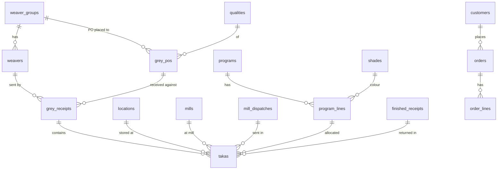

# 03 — Data Model (SQLite / Turso)

Source of truth in code: `src/db/schema.js`. Keep this file in sync.
IDs are INTEGER autoincrement. Dates are ISO `YYYY-MM-DD` text.

## Masters
| Table | Columns |
|---|---|
| `weaver_groups` | id, name, contact, phone, city |
| `weavers` | id, group_id, name, gstin, phone |
| `mills` | id, name, contact, phone, city |
| `customers` | id, name, contact, phone, city |
| `qualities` | id, original_name, nick_name, taka_length (default 100), notes |
| `locations` | id, shop, rack |
| `shade_charts` | id, name |
| `shades` | id, chart_id, number, name, hex |

## Transactions
| Table | Columns |
|---|---|
| `grey_pos` | id, po_no, po_date, group_id, quality_id, meters, rate, taka_length, due_date, notes, image_url, closed (0/1) |
| `grey_receipts` | id, po_id, weaver_id, challan_no, date, destination (`GODOWN`/`MILL`), mill_id, image_url, notes |
| `takas` | id, receipt_id, taka_no, grey_meter, status, location_id, mill_id, dispatch_id, program_line_id, finished_receipt_id, mill_grey_meter, finished_meter, folded_meter, folded_on, order_id |
| `mill_dispatches` | id, dispatch_no, date, mill_id, notes |
| `programs` | id, program_no, date, mill_id, quality_id, chart_id, notes |
| `program_lines` | id, program_id, shade_id, taka_count |
| `finished_receipts` | id, program_id, challan_no, date, image_url, notes |
| `orders` | id, order_no, date, customer_id, quality_id, notes, status (`OPEN`/`DONE`) |
| `order_lines` | id, order_id, shade_id, taka_count |

## Derived values (computed in `repo.js`, never stored)
- PO received m = Σ takas.grey_meter of its receipts; PO status = closed ? COMPLETED : received==0 ? OPEN : received ≥ meters ? COMPLETED : PARTIAL.
- Weaver shrinkage per taka = taka_length − grey_meter (null when receipt.destination = MILL).
- Finished shrinkage = (mill_grey_meter ?? grey_meter) − finished_meter.
- Folding shrinkage = finished_meter − folded_meter.
- Program line received = count(takas where program_line_id = line and finished_receipt_id not null).
